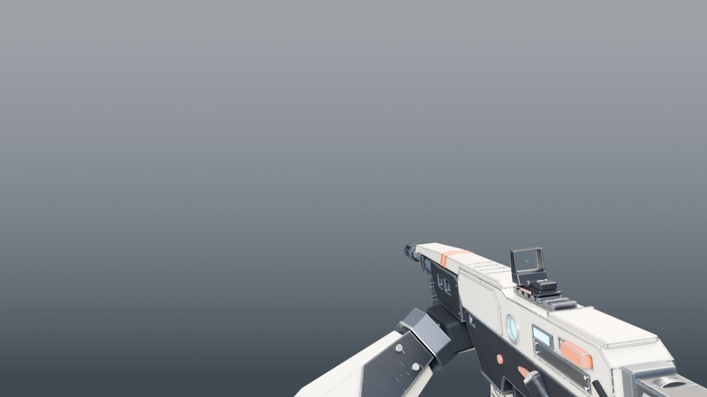
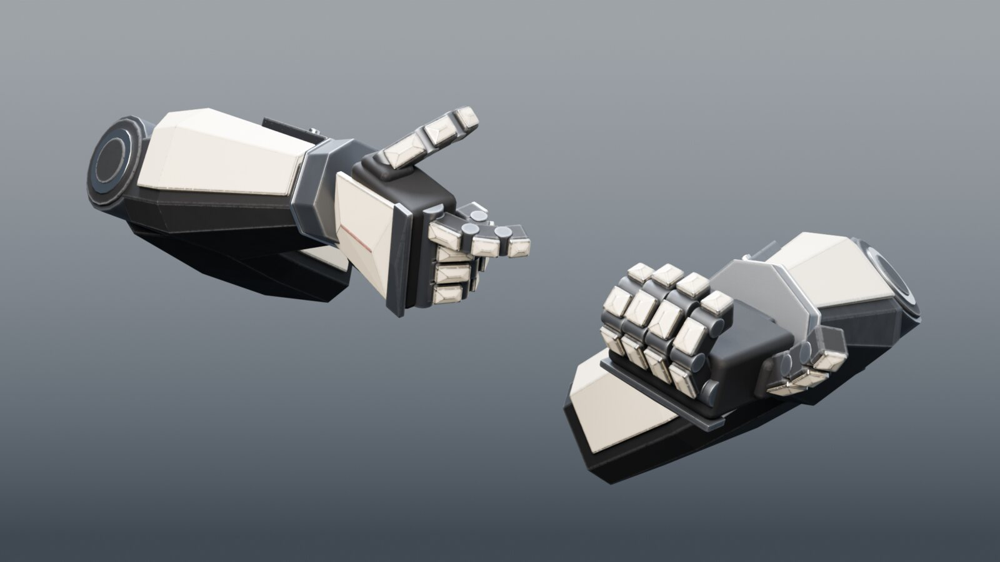
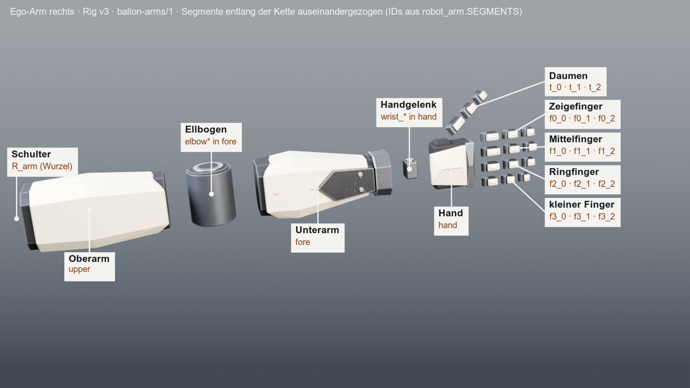

# 0.40.0 „Brace“ – Ego-Arme: drei Renders und das Arm-Paket `ballon-arms/1`

**Fertig, Entscheidung nötig** (letzter Richterbefund niedrig, siehe Prüfung). Die drei Renders sind gesichtet und abgelegt. Das Paket `packages/ego-arms/` ist erzeugt, getestet und im
README erklärt. `./check` ist grün. `ego.json` und `arms.fbx` im Unity-Ordner sind bytegleich zu 0.39.1. Nicht geprüft ist der
Import des Pakets in Unity oder bei einem Abnehmer (kein Unity-Lauf, siehe unten). Nachtrag: Das Paket trägt jetzt Texturen
(Grundfarbe, ORM, Normale auf den UVs des Unity-Atlas).

**Rahmen:** Sitzung „BALLON 0.40 „Brace“ · Mac“, Claude Opus 5.5, Denkaufwand high (Entwurf eines Lieferpakets, Blender nötig),
keine Unteragenten. Der vorgesehene Name „Gauntlet“ war schon zweimal vergeben (0.23 und 0.31, Branches `claude/ballon-0.23-gauntlet*`
noch offen), deshalb heißt die Version „Brace“. Basis `main` 123b3e4 (0.39.1), Branch `claude/ballon-0.40-brace`.

## Auftrag

Nutzerwunsch 02.11.2026: „ein, zwei, drei Render der Ego-Arme und einen generellen Aufbau der Ego-Arme als Paket“.

| Ziel | Fertig wenn | Stand |
|---|---|---|
| 1 Drei Renders (Cycles, 1920×1080, dazu 960er) | gesichtet, im Cache und in `docs/bilder/` (≤ 400 KB) | erledigt |
| 2 Arm-Paket `ballon-arms/1` nur aus dem Generator | GLB/FBX, Manifest, README, Kontaktbogen; Test bytegleich, Manifest gegen `robot_arm.py`, Reimport | erledigt |
| 2b Texturen im Paket (Nachtrag des Nutzers: „Ja, mit Texturen“) | Paket trägt gebackene Texturen, Reimport erhält UVs und Material | erledigt |

Nicht angefasst: Haltungen, Clips, Arm-Geometrie und Rig-Werte (`RIG_VERSION` 3), das Format von `ego.json`, die Unity-Laufzeit.

## Die drei Renders

**a) Spielbild:** BASIC-01 (Automatik) in der Hüfthaltung, Ego-Kamera wie im Spiel (75° horizontal). Die Hände stehen wie im
Standbild der Haltung (`ego_build.still_action`). Wie im Spiel liegt die Griffhand rechts unter dem Bildrand. Sichtbar sind die
Stützhand am Handschutz und der linke Unterarm. Das alte Ego-Standbild `hip_ego.png` hat denselben Ausschnitt. Beide Arme ganz
zeigt b).

**b) Arme allein, Studio:** dieselbe Haltung ohne Waffe, 3/4 von vorn oben. Links im Bild ist die Griffhand (rechte Hand, `trigger`,
Zeigefinger gestreckt), rechts die Stützhand (linke Hand, `underhand`). Die Kamera wird am Hüllquader der Arme eingepasst.

**c) Aufbauansicht:** der rechte Arm in der Ruhelage des Pakets, entlang der Kette auseinandergezogen und mit den IDs aus
`robot_arm.SEGMENTS` beschriftet. Schulter, Ellbogen und Handgelenk sind keine eigenen Segmente. Die Schulter ist die Wurzel `R_arm`,
die Ellbogenteile gehören zu `fore`, der Kardanblock zu `hand`. So sind sie im Bild auch beschriftet. Nur für die Ansicht ist der
Arm 55° um seine Längsachse gerollt, sonst läge der Daumen verdeckt unter der Hand.

Erzeugt von `tools/arm_renders.py` unter `ce lock gpu` (192 Samples, M5-GPU, 38 s für alle drei). `--annotate` beschriftet neu, ohne
Blender. Ablage: `~/Library/Caches/CubeEscapeBallon/0.40/belege/renders/` mit `a_spielbild.png`, `b_studio.png`, `c_aufbau.png`
(1920×1080), `c_aufbau_roh.png` (ohne Beschriftung), je `*_960.jpg` und `renders.json` (Kamera, Samples, Messwerte). Im Repo liegen
`docs/bilder/ego-arme-{spielbild,studio,aufbau}.jpg` mit 1600 px Breite (48, 68, 85 KB).

## Das Arm-Paket

**Ort:** `packages/ego-arms/`. Das ist ein eigener Ordner, weil das Paket eine Lieferung mit Binärdateien für Abnehmer außerhalb von
BALLON ist. Weitere Arm-Sets kommen als `packages/<set>-arms/` dazu. Unter `unity/` würde es nach BALLON-Unity aussehen, unter
`data/` liegen nur Python-nahe Daten.

| Datei | Inhalt |
|---|---|
| `arms.glb` (9,9 MB) | beide Arme in der Ruhelage, glTF 2.0 mit eingebetteten Texturen. Neu erzeugt ist es bytegleich (ohne neues Backen), der SHA-256 steht im Manifest |
| `arms.fbx` (1,1 MB) | dieselbe Hierarchie, Texturen relativ verlinkt, ohne „Apply Transform“: jeder Knoten trägt seine lokale Lage (LESSONS: mit Apply Transform kamen Kindknoten falsch an) |
| `manifest.json` | `format ballon-arms/1`, `rig_version` 3, Einheiten und Achsen, 18 Segmente mit Eltern, Länge, Gelenk, Ruhelage (lokal und Welt), gemessene Netzmaße, Grenzen (Handgelenk 45°/55°, genutzte Fingerwinkel), Anker, Andocken (Regel und Griffe der Pilotwaffe), 9 Fingerposen, 6 Materialrollen, 67 Teile, Dreiecke je Segment und Seite (11 536 je Seite), Quellhash |
| `README.md` | Aufbau (Kette, Segmenttabelle, Rahmen), Gelenke, Anker, Andocken einer Waffe, was ein Abnehmer braucht (alle, Ego-Ansicht, Roboter von außen), was ewig ist, Platz für weitere Sets |
| `textures/` (8,8 MB) | Grundfarbe, ORM, Normale (2048²) und `bake.json`, siehe Abschnitt Texturen |
| `contact.jpg` | vier Ansichten aus dem wieder eingelesenen GLB: Workbench (Grundfarbe) und EEVEE (volles Material) |

**Aufbau:** Wurzel `<S>_arm` (Schultergelenk) → `upper` → `fore` → `hand` → je Finger drei Glieder und der Daumen. Die Teile hängen
unter ihrem Segment. Die Anker `Socket_Palm` (Griffpunkt = `ego_build.PALM_CENTER`), `Socket_IndexTip` und `Socket_ThumbTip` sind
Leerknoten. In der Ruhelage sind die Arme gestreckt nach vorn, Handrücken oben, Finger gestreckt. Finger und Daumen rechnen mit
denselben Formeln wie `ego_build.solve_arm`. Die Netze baut `ego_build.build_arm`, also dieselben Teile wie im Unity-`arms.fbx`. Die
Materialien heißen nach ihrer Rolle und tragen alle dieselben Paket-Texturen (Abschnitt Texturen). Andocken:
`Socket_Palm` liegt auf `contact` des Griffs, sein +Z zeigt entlang `fingers`, sein −Y entlang `palm`. Nutzerentscheid 143 (Arm-Set
Ego/Roboter) bleibt offen. Das README hält nur Platz für weitere Sets frei.

**Befund Ellbogen (gemessen, nicht geändert):** Der Gelenkzylinder `elbow*` liegt auf Segment-X. Der Löser richtet Ober- und
Unterarm aber einzeln aus und beugt dabei nicht um X:

| Haltung | Seite | Drehung Oberarm → Unterarm | Achse im Oberarmrahmen |
|---|---|---|---|
| hip | R / L | 64,8° / 65,7° | (0,04, 0,99, −0,10) / (−0,11, −0,98, 0,20) |
| sprint | R / L | 96,5° / 136,4° | (−0,17, 0,99, 0,01) / (0,16, −0,99, −0,07) |
| reload | R / L | 56,5° / 171,6° | (0,24, 0,94, 0,25) / (0,06, 0,82, 0,57) |
| ads | R / L | 166,7° / 139,4° | (−0,06, −0,89, −0,45) / (0,03, −0,90, −0,44) |

Das Manifest führt den Ellbogen deshalb als freies Gelenk (`ball`) mit dem Zylinder als `visual_axis` x und schreibt kein Scharnier
vor, das der Löser nicht einhält. Ob der Ellbogen sichtbar falsch dreht (die Scheibe zeigt zur Kamera, während der Arm seitlich
knickt), ist eine Frage für eine eigene Aufgabe.

## Texturen (Nachtrag)

Nach dem ersten Lieferpaket wollte der Nutzer die Arme „mit Texturen“. Der gebackene Unity-Arm-Atlas ist im Spezular-Modell
(Diffus = Grundfarbe · (1 − Metall), Spiegelfarbe F0, Glätte im Alpha). glTF erwartet Metall-Rauheit. Deshalb:

- **UVs:** aus dem Unity-`arms.fbx`, auf dem der Atlas gebacken ist. Alle 134 Netze stimmen dort mit den Paketnetzen überein
  (Ecken, Schleifen, Reihenfolge, Lage), die UVs werden Schleife für Schleife übernommen. Ein abweichendes Netz bricht den Export ab.
- **Backen** (`export_arms.py -- --bake --gpu`, 28 s auf der M5-GPU): Grundfarbe, Rauheit, Metall und Verdeckung aus den
  kit-AAA-Materialien, in derselben Backszene wie `export_unity.bake_arms` (Segmente nebeneinander, alle Teile zusammengefügt). So
  liegen die Abriebmuster gleich. Die Normale kommt als 8-Bit-Kopie aus dem Unity-Atlas.
- **Dateien:** `textures/arms_basecolor.png` (sRGB), `arms_orm.png` (R Verdeckung, G Rauheit, B Metall), `arms_normal.png`, je 2048²,
  zusammen 8,8 MB, dazu `bake.json` (Herkunft, Gegenprobe). Im GLB eingebettet (9,9 MB), im FBX relativ verlinkt (nur Grundfarbe und
  Normale, die ORM-Textur muss man dort selbst anschließen).
- **Gegenprobe:** Grundfarbe · (1 − Metall) gegen den Unity-Diffusatlas weicht im Mittel um 2,1/255 ab, 99 % der Texel um
  ≤ 22,6. Die Abweichungen liegen an den Inselkanten (Kantenabrieb ist ein Zufallsverfahren, 8-Bit-Rundung).
- **Befund Unity-AO:** In der Unity-AO sind an mehreren Inseln Formen eingedrückt. `bake_arms` legt den rechten Oberarm in den Ursprung,
  wo die Waffe steht. Die eigene Verdeckung ohne Waffe weicht dort ab (2,6 % der Texel > 30/255) und ist sauber. Das Paket nutzt sie.
  Den Unity-Atlas habe ich nicht geändert. Ob er neu gebacken werden soll, ist eine eigene Aufgabe.
- **Grenze:** glTF kennt keinen Specular-Wert je Rolle. Graphit (kit 0,25, also F0 0,02) glänzt im GLB mit F0 0,04 etwas stärker.
- **Sichtung:** Der Kontaktbogen zeigt das wieder eingelesene GLB in Workbench (Grundfarbe) und in EEVEE mit vollem Material unter dem
  Studiolicht der Renders. Graphit, Schale und Zierkanten lesen sich wie in den Cycles-Renders. Flächengewichtet gemessen: Schale
  Grundfarbe (0,82, 0,78, 0,70), Rauheit 0,53, Metall 0,10 (Kantenabrieb).
- **Prüfung:** Der Test vergleicht zusätzlich die UVs je Teil (UV-Fläche und Schwerpunkt, GLB und FBX gegen die Exportszene), die
  Texturen am Material (GLB: drei eingebettet, FBX: Grundfarbe gefunden) und beim Neuerzeugen die Netzmaße. Gegenprobe 5/5
  (dazu um 0,001 verschobene UVs). Ohne neues Backen bleibt das GLB bytegleich. `--check` meldet, wenn der Unity-Atlas oder
  `arms.fbx` neu gebacken wurde (Quellhash in `bake.json`) oder sich die kit-Materialien der Armrollen bzw. die Material- und
  Backfunktionen geändert haben (inhaltlicher Fingerabdruck `material_sha256`). Dann muss `--bake` neu laufen; der Export lehnt bis
  dahin ab. Die UV-Übernahme verlangt zusätzlich gleiche Eckpositionen (≤ 0,01 mm). Gegengeprüft im Test: veralteter Fingerabdruck,
  geänderte Unity-Quelle, gleiche Topologie mit um 1 mm verschobenen Ecken.

## Prüfung

- `./check` grün (40 s), mit zwei neuen Stufen:
  - `python3 tools/export_arms.py --check` vergleicht Manifest und README mit `robot_arm.py`, `ego.py`, `kit.py`, `parts_sha256`
    und dem GLB-Hash. Ändern sich `ego_build.py` oder `kit.py`, gibt es nur einen Hinweis, entscheiden muss der Blender-Test.
  - `tools/test_arm_package.py` (Blender, ≈ 1 s) liest GLB und FBX ein und prüft 178 Knoten: Namen, Eltern, Art, Rolle als
    Material, Weltlage ≤ 0,05 mm, Weltdrehung ≤ 0,01°, Maßstab 1. Dazu kommen 134 Netz-Hüllquader gegen die Exportszene und die
    Dreiecke je Segment, beim Neuerzeugen auch die Netzmaße. Gegenprobe 4/4: falscher Elternknoten, 1 mm verschobene Hand, 1° verdrehter Griffpunkt und 1 mm
    verschobenes Netz werden erkannt. Das neu erzeugte GLB ist bytegleich.
- Unity unverändert: `shasum` von `unity/Assets/Ballon/Generated/arms.fbx` (a57b37d5…) und `ego.json` (2af03125…) ist gleich
  vor und nach allen Läufen (`~/Library/Caches/CubeEscapeBallon/0.40/belege/unity_vorher.sha256`).
- Richter `./ce judge` (gpt-6.1-sol high, Kontingent 58 % frei), Checkliste `pruefung.md`. Runde 1 ergab **Nachbessern 4, 6**:
  Der Reimport prüfte keine Drehungen und Netzlagen, und dieser Bericht fehlte. Beides ist ergänzt (Weltdrehungen im Manifest,
  Prüfung von Drehung, Maßstab und Hüllquader, zwei zusätzliche Gegenproben). Runde 2 ergab **Nachbessern 4, 6 (beide niedrig)**:
  (4) kein Eintrag in `test_map.json`. Das ist eine Cube-Escape-Einrichtung, BALLON hat keine, hier ordnet `./check` die Tests zu
  (unverändert). (6) Die Längen im README waren Rig-Konstanten statt Messwerte. Jetzt heißen sie „Gelenkabstand (Rig)“, und neben
  ihnen stehen die am exportierten Netz gemessenen Maße je Segment (`mesh_bounds_mm`, vom Test beim Neuerzeugen verglichen). Runde 3
  ergab **Freigabe** (alle acht Punkte ok).
- Richter zum Texturstand (gpt-6.1-sol high), drei Runden:
  - T1: Nachbessern 4 (hoch): Der Fingerabdruck kannte nur Unity-Dateien, jetzt enthält er auch die kit-Materialien und
    Backfunktionen. Dazu 6 (niedrig): Bericht auf den Endstand gebracht.
  - T2: Nachbessern 4 (hoch): Die UV-Übernahme prüft jetzt auch die Eckpositionen. Dazu 4 (niedrig): Der Quellhash wird jetzt schon vor
    dem Export geprüft. Beides mit Gegenproben.
  - T3: Nachbessern 4 (niedrig): Der UV-Vergleich über Fläche und Schwerpunkt erkennt eine Spiegelung um den Schwerpunkt nicht, und die
    Materialprüfung kontrolliert die ORM- und Normalen-Verknüpfung nicht im Einzelnen. Nach der Korrektur-Obergrenze (dritte Runde zu
    Punkt 4) habe ich angehalten. **Entscheidung des Nutzers nötig:** nachbessern oder so annehmen.
- Hinweise in `./check` zur Freihaltezone („Messung veraltet“) gab es schon vorher. Keine ihrer Quellen wurde geändert.

**Nicht geprüft:** Import von `arms.glb`/`arms.fbx` in Unity, Cube Escape oder anderen Programmen als Blender. Das Achsverhalten des
FBX in Unity ist nicht gemessen. Laut Cube Escape `FIRST_PERSON_EQUIPMENT.md` › 11.1 liegt bei Toolgens Arm-Paket die Achsdrehung auf
der Dateiwurzel, für dieses Paket ist das nicht belegt. Bytegleichheit gilt für dieselbe Blender-Version (5.2.2).

## Ist-Zeit

Etwa 65 min bis zum ersten PR: Warten 0 min (alle Sperren frei, Richter im Vordergrund mitgezählt), Rechnen 12 min (Blender-Exporte
und -Tests je ≈ 2 s, Renders 3 × 22–38 s, `./check` 3 × 40 s, Richter 3 Runden), Lesen 17 min, Umsetzen 30 min. Nachtrag Lieferpaket
und Texturen etwa 45 min: Warten 0 min, Rechnen 6 min (drei Backläufe je ≈ 25 s, Exporte, Tests, `./check`, Richter), Lesen 9 min
(Backweg, Atlas, Abgleich), Umsetzen 30 min.

## Aufräumen nach dem Merge

Freigabe des Nutzers liegt vor: `report.md`, die Temp-Ordner `ballon_arms_*` und `c_aufbau_roh.png` löschen. Die Renders und die
Unity-Hashes in `~/Library/Caches/CubeEscapeBallon/0.40/belege/` bleiben als Belege der aktuellen Version. Danach den Worktree
sauber entfernen und im Postfach melden.
