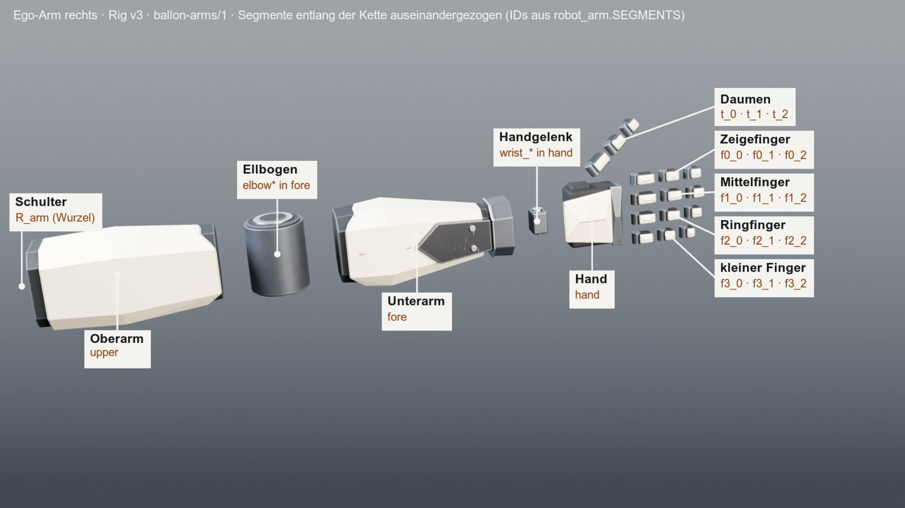

# Ego-Arme – Paket `ballon-arms/1`

Erzeugt von `tools/export_arms.py` (BALLON), nie von Hand bearbeiten. Rig-Version 3, Set `ego`. Quelle der Form ist `basic/arms/robot_arm.py`; Haltungen, Griffe und Fingerposen kommen aus `basic/arms/ego.py`.



## Dateien

| Datei | Inhalt |
|---|---|
| `arms.glb` | beide Arme, glTF 2.0 binär, 23072 Dreiecke, Bytes reproduzierbar (SHA-256 im Manifest) |
| `arms.fbx` | dieselbe Hierarchie als FBX (ohne „Apply Transform“) |
| `manifest.json` | Maschinenlesbar: Segmente, Eltern, Längen, Gelenke, Grenzen, Anker, Fingerposen, Rollen, Dreiecke, Quellhash |
| `contact.jpg` | Kontaktbogen aus dem wieder eingelesenen GLB (Workbench) |

## Aufbau

Ein Arm besteht aus **starren Teilen**, die je an genau einem **Segment** hängen. Es gibt kein Skinning und keine Knochen. Ein Gelenk ist der Ursprung eines Segments, und bewegt wird, indem man die lokale Drehung des Segmentknotens setzt.

```
<S>_arm                      Wurzel = Schultergelenk (S = R oder L)
└─ <S>_upper                 Oberarm
   └─ <S>_fore               Unterarm, Ellbogengelenk an seinem Ursprung
      └─ <S>_hand            Hand, Kardanblock an ihrem Ursprung (Handgelenk)
         ├─ <S>_Socket_Palm  Griffpunkt
         ├─ <S>_f0_0 → f0_1 → f0_2 → <S>_Socket_IndexTip   Zeigefinger
         ├─ <S>_f1_0 → f1_1 → f1_2                        Mittelfinger
         ├─ <S>_f2_0 → f2_1 → f2_2                        Ringfinger
         ├─ <S>_f3_0 → f3_1 → f3_2                        kleiner Finger
         └─ <S>_t_0 → t_1 → t_2 → <S>_Socket_ThumbTip     Daumen
   (jeder Segmentknoten trägt seine Teile <S>_<teil> als Kinder)
```

| Segment | Teil des Arms | Eltern | Gelenk | Achsen | Länge (mm) | Teile | Dreiecke R |
|---|---|---|---|---|---|---|---|
| `upper` | Oberarm | `arm` | Schulter (ball) | x, y, z | 320.0 | 2 | 484 |
| `fore` | Unterarm mit Ellbogen | `upper` | Ellbogen (ball) | x, y, z | 300.0 | 12 | 2584 |
| `hand` | Hand mit Kardanblock | `fore` | Handgelenk: Kardan in der Stulpe, Hand dreht frei (ball) | x, y, z | 87.4 | 8 | 1164 |
| `f0_0` | Zeigefinger, Glied 1 | `hand` | Fingergelenk (hinge) | x | 30.9 | 3 | 480 |
| `f0_1` | Zeigefinger, Glied 2 | `f0_0` | Fingergelenk (hinge) | x | 24.6 | 3 | 496 |
| `f0_2` | Zeigefinger, Glied 3 | `f0_1` | Fingergelenk (hinge) | x | 20.0 | 3 | 496 |
| `f1_0` | Mittelfinger, Glied 1 | `hand` | Fingergelenk (hinge) | x | 32.8 | 3 | 468 |
| `f1_1` | Mittelfinger, Glied 2 | `f1_0` | Fingergelenk (hinge) | x | 26.0 | 3 | 480 |
| `f1_2` | Mittelfinger, Glied 3 | `f1_1` | Fingergelenk (hinge) | x | 21.2 | 3 | 496 |
| `f2_0` | Ringfinger, Glied 1 | `hand` | Fingergelenk (hinge) | x | 30.9 | 3 | 480 |
| `f2_1` | Ringfinger, Glied 2 | `f2_0` | Fingergelenk (hinge) | x | 24.6 | 3 | 496 |
| `f2_2` | Ringfinger, Glied 3 | `f2_1` | Fingergelenk (hinge) | x | 20.0 | 3 | 496 |
| `f3_0` | kleiner Finger, Glied 1 | `hand` | Fingergelenk (hinge) | x | 26.0 | 3 | 480 |
| `f3_1` | kleiner Finger, Glied 2 | `f3_0` | Fingergelenk (hinge) | x | 20.6 | 3 | 496 |
| `f3_2` | kleiner Finger, Glied 3 | `f3_1` | Fingergelenk (hinge) | x | 16.8 | 3 | 496 |
| `t_0` | Daumen, Glied 1 | `hand` | Daumensattel (saddle) | y, x | 32.8 | 3 | 468 |
| `t_1` | Daumen, Glied 2 | `t_0` | Daumengelenk (hinge) | x | 25.5 | 3 | 480 |
| `t_2` | Daumen, Glied 3 | `t_1` | Daumengelenk (hinge) | x | 20.0 | 3 | 496 |

**Schulter, Ellbogen, Handgelenk** sind keine eigenen Segmente. Die Schulter ist die Wurzel `<S>_arm`. Die Ellbogenteile (`elbow`, `elbow_disc`, `elbow_ring`, `elbow_hub`) liegen im Ursprung von `fore`, der Kardanblock (`wrist_block`, `wrist_pin`) im Ursprung von `hand`.

## Rahmen, Achsen, Ruhelage

- Paketraum: Blender, rechtshändig: rechts −X, vorn −Y, oben +Z (wie der Ego-Kameraraum in ego.json). Einheiten: Meter, Grad.
- Segmentrahmen: Ursprung im Gelenk am Segmentanfang, +Z entlang des Segments, +Y Panzerseite/Handrücken, −Y Handfläche, +X Daumenseite der rechten Hand (links gespiegelt: Daumen auf −X).
- GLB: glTF 2.0 (+Y oben): der Blender-Exporter rechnet (x, y, z) → (x, z, −y). FBX: Achsen forward −Z, up Y, Meter (FBX_SCALE_ALL), ohne „Apply Transform“: jeder Knoten trägt seine lokale Lage.
- Ruhelage: Arme gestreckt nach vorn (−Y), Handrücken oben, Finger gestreckt (alle Winkel 0), Daumen in seiner Grundrichtung (out = 30°, flex = tip = 0); keine Ego-Haltung. Wurzeln bei R [-0.2, 0.0, 0.0] m und L [0.2, 0.0, 0.0] m, gedreht +90° um X.
- Die linke Seite ist an der Segment-X-Achse gespiegelt: gleiche Rahmen (rechtshändig), gespiegelte Netze, Versätze mit −x.

## Gelenke und Grenzen

- Finger: Drehung um X, positiv beugt zur Handfläche. Ein Fingerglied `f<i>_<j>` = Versatz · Rx(Winkel).
- Daumen: `t_0` = Versatz · Grundrichtung · Ry(−s·(out − 30°)) · Rx(flex); s = +1 rechts, −1 links, `t_1` = Rx(0,6 · tip), `t_2` = Rx(tip).
- Handgelenk: Knick (Unterarm-Z zu Hand-Z) Ziel 45°, Grenze 55°. Die Hand dreht in der Stulpe frei.
- Ellbogen: Der Gelenkzylinder elbow* liegt auf X. solve_arm richtet Ober- und Unterarm einzeln aus (Richtung plus Blickhinweis) und beugt dabei nicht um X: gemessen 0.40 liegt die Beugeachse nahe Segment-±Y.
- Fingergrenzen legt das Rig nicht fest. Genutzt werden: Finger je Glied [[4, 76], [4, 84], [3, 60]]°, Daumen flex [6, 80]°, out [5, 34]°, tip [4, 60]°.

## Anker

| Anker | Segment | Lage R (mm, Segmentrahmen) | Bedeutung |
|---|---|---|---|
| `<S>_Socket_Palm` | `hand` | [0.0, -22.932, 50.05] | Griffpunkt: Mitte der Handfläche auf ihrer Oberfläche; +Z Fingerrichtung, −Y zeigt in den Griff (ego_build.PALM_CENTER) |
| `<S>_Socket_IndexTip` | `f0_2` | [0.0, 0.0, 20.02] | Spitze des Zeigefingers (Abzugsfinger), Ende des dritten Glieds |
| `<S>_Socket_ThumbTip` | `t_2` | [0.0, 0.0, 20.02] | Daumenspitze, Ende des dritten Daumenglieds |

## Wie eine Waffe andockt

Eine Waffe beschreibt je Griff contact (Autorenmaß f vorn, u oben, x links in mm), palm (Richtung von der Handfläche in das Bauteil), fingers (Fingerrichtung) und fingers_pose. Die Hand sitzt so, dass Socket_Palm auf contact liegt, sein +Z entlang fingers und sein −Y entlang palm zeigt: Hand = Griffrahmen · Socket_Palm⁻¹ (ego_build.grip_hand). Autorenmaß → Blender: (x, −f, u) / 1000.

Beispiel Pilotwaffe BASIC-01-v2.1:

| Griff | Teil | contact (f, u, x mm) | palm | fingers | Fingerpose |
|---|---|---|---|---|---|
| `grip` | Waffe | [-3, -6, -16.5] | [0.15, 0.0, 1.0] | [1.0, -0.06, 0.0] | `trigger` |
| `support` | Waffe | [278, 61.5, -2] | [0.0, 1.0, -0.25] | [0.08, 0.15, -1.0] | `underhand` |
| `mag` | magazine | [114, -18, 13.5] | [0.0, 0.0, -1.0] | [1.0, 0.45, 0.0] | `mag_hold` |
| `charge` | charging_handle | [-84, 112, 30] | [0.0, 0.0, -1.0] | [0.45, 0.9, 0.0] | `pinch` |

Die Waffe selbst hängt über ihren `Socket_Hand` in der Haltung (ego.py `POSES`). Griffhand rechts = `grip`, Stützhand links = `support`.

## Fingerposen

f: je Finger (Zeige-, Mittel-, Ring-, kleiner Finger) drei Gliedwinkel; t: Daumen [flex, out, tip].

| Pose | Zeige | Mittel | Ring | klein | Daumen |
|---|---|---|---|---|---|
| `open` | [4, 4, 3] | [4, 4, 3] | [4, 4, 3] | [4, 4, 3] | [6, 34, 4] |
| `relaxed` | [14, 18, 12] | [18, 22, 14] | [22, 26, 16] | [26, 30, 18] | [12, 30, 8] |
| `grip` | [62, 74, 48] | [62, 74, 48] | [62, 74, 48] | [62, 74, 48] | [38, 12, 30] |
| `trigger` | [20, 30, 18] | [62, 74, 48] | [64, 76, 50] | [66, 78, 52] | [38, 12, 30] |
| `underhand` | [52, 66, 44] | [52, 66, 44] | [52, 66, 44] | [52, 66, 44] | [20, 10, 16] |
| `mag_hold` | [36, 46, 30] | [36, 46, 30] | [36, 46, 30] | [36, 46, 30] | [30, 24, 20] |
| `pinch` | [46, 56, 36] | [70, 80, 56] | [74, 82, 58] | [76, 84, 60] | [46, 18, 34] |
| `foregrip` | [62, 74, 48] | [62, 74, 48] | [62, 74, 48] | [62, 74, 48] | [80, 5, 60] |
| `foregrip_open` | [4, 4, 3] | [4, 4, 3] | [4, 4, 3] | [4, 4, 3] | [80, 5, 60] |

## Materialrollen

Netze tragen je Teil eine Rolle als Materialname; Farbe in GLB/FBX = aaa_color, keine Texturen. Der gebackene Arm-Atlas liegt nur im Unity-Ordner (unity/Assets/Ballon/Generated/Textures/arms_{albedo,spec,normal,ao}.png).

| Rolle | Farbe | AAA-Farbe | Rauheit | Metall | Bedeutung |
|---|---|---|---|---|---|
| `accent` | #E0651E | #E0651E | 0.5 | 0.0 | Akzent Orange (Bedienelement) |
| `anodized` | #202227 | #202227 | 0.4 | 0.6 | Schwarz eloxiert |
| `dark_metal` | #4A4E55 | #4A4E55 | 0.45 | 0.8 | Brüniertes Metall |
| `graphite` | #2C2E33 | #141518 | 0.75 | 0.0 | Griffpolymer / Graphit |
| `shell` | #D8CCB4 | #D8CCB4 | 0.55 | 0.0 | Lackiertes Gehäuse (Creme) |
| `trim` | #C9CDD2 | #C9CDD2 | 0.22 | 1.0 | Blanke Zierkante |

## Was ein Abnehmer braucht

- **Alle:** `manifest.json` lesen und `format` prüfen (`ballon-arms/1`, sonst abbrechen). Dann `arms.glb` oder `arms.fbx` laden, Knoten über die Namen `<S>_<segment>` und `<S>_<anker>` finden und nie über die Reihenfolge.
- **Ego-Ansicht (Cube Escape, BALLON-Unity):** Die Wurzel kommt an die Schulter im Kameraraum (`ego.shoulder_m`). Die Hand wird über `Socket_Palm` an den Griff der Waffe gelegt. Der Unterarm folgt der Hand mit dem Knick ≤ 45° (`ego_build.solve_arm`), der Oberarm zeigt zur Schulter. Die Finger kommen aus `finger_poses`. Zum Vergleich die Toolgen-Knoten in Cube Escape: `UpperArm_*`, `LowerArm_*`, `Hand_*`, `Fingers_*_0..2`, `Thumb_*`, `Wrist_*`, `GripContact_*` (Cube Escape Docs/FIRST_PERSON_EQUIPMENT.md › 11); eine Namenszuordnung legt dieses Paket nicht fest.
- **Roboter von außen (Critic, Figur):** Die Wurzel `<S>_arm` sitzt im Schultergelenk des Rumpfs. Die Gelenkachsen und Längen stehen in `segments`. Die Hand greift über `Socket_Palm` wie oben.
- **Material:** Rolle je Teil (Materialname); eigene Shader sollen die Werte aus `materials` nutzen.

## Was ewig ist

- Segment-IDs aus `robot_arm.SEGMENTS`: `upper`, `fore`, `hand`, `f0_0`, `f0_1`, `f0_2`, `f1_0`, `f1_1`, `f1_2`, `f2_0`, `f2_1`, `f2_2`, `f3_0`, `f3_1`, `f3_2`, `t_0`, `t_1`, `t_2`.
- Anker-Namen: `Socket_Palm`, `Socket_IndexTip`, `Socket_ThumbTip`. Knotennamen `<S>_…` mit S = R/L, Wurzel `<S>_arm`.
- Teil-IDs (englisch snake_case) und Rollennamen.
- Umbenennen oder Entfernen nur mit `ballon-arms/2` und einem Migrationshinweis. Neue Felder, Teile oder Anker dürfen dazukommen.

## Weitere Arm-Sets

Dieses Paket beschreibt die heutigen Ego-Arme (Set `ego`). Ob es ein eigenes Arm-Set für den Roboter gibt, entscheidet der Nutzerentscheid 143 (Arm-Set Ego/Roboter), der noch offen ist. Ein weiteres Set bekäme einen eigenen Ordner `packages/<set>-arms/` im selben Format, mit eigenem `set` und denselben Segment- und Ankernamen, soweit es die Glieder gibt.

## Prüfen

- `python3 tools/export_arms.py --check` (in `./check`): Manifest und README passen zu `robot_arm.py`, `ego.py`, `kit.py`.
- `blender -b --factory-startup -P tools/test_arm_package.py` (in `./check`, wenn Blender vorhanden ist): GLB neu erzeugt ist bytegleich, die Dreiecke stimmen, und der Reimport von GLB und FBX erhält Teile, Hierarchie, Anker und die Ruhelage.
- Neu erzeugen: `ce lock blender -- blender -b --factory-startup -P <abs>/tools/export_arms.py`.
